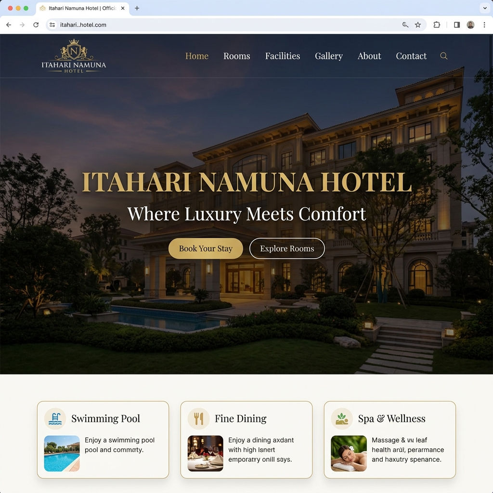
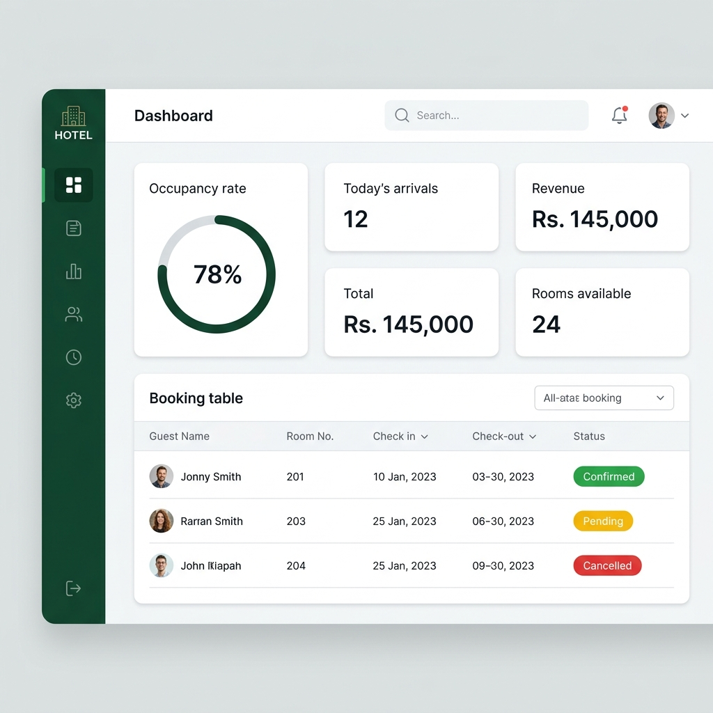
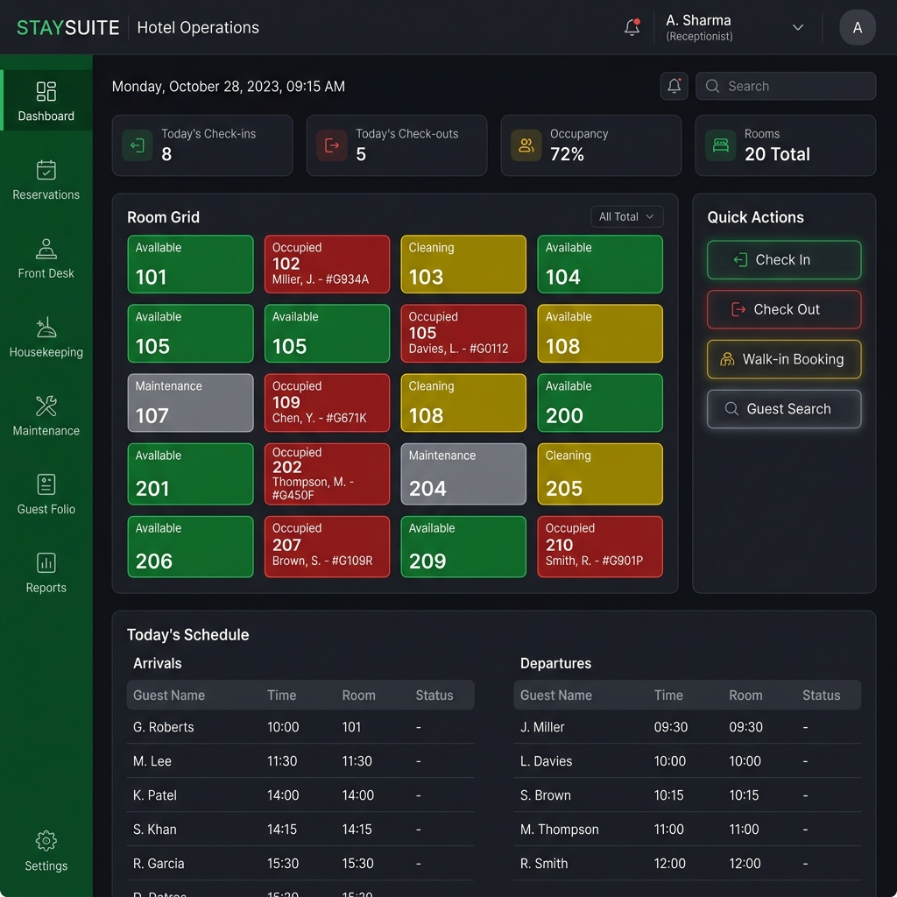
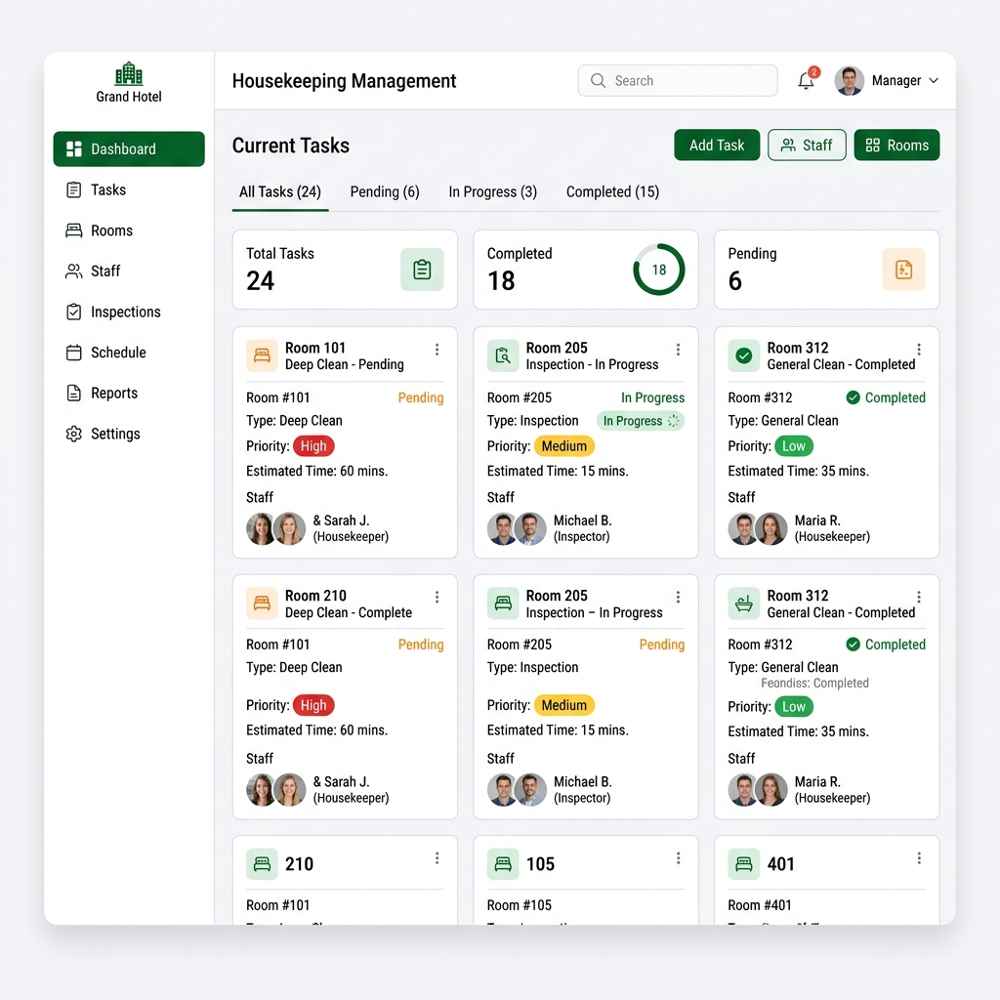

<div align="center">
  <p><strong>F I R S T&nbsp; S T A Y</strong></p>
  <h1>Book a room. We’ll have the key ready.</h1>
  <p><em>A considered hotel experience for guests—and a clearer way to run the stay for staff.</em></p>
  <p><strong>Discover · Book · Welcome · Manage</strong></p>
</div>

---

## The experience

First Stay is a hotel booking and property-management platform. Guests can discover rooms, make a reservation, and manage their stay, while hotel teams coordinate front-desk, room, and housekeeping workflows from role-specific workspaces.

The interface takes its cue from the hotel itself: deep forest-green, warm gold accents, refined editorial headings, and clear, welcoming guest experiences.

## At a glance

| Guest experience | Hotel operations |
| --- | --- |
| Browse rooms, venues, facilities, and guest reviews | Coordinate arrivals, departures, room status, and service orders |
| Create an account, book a stay, and review booking details | Manage room inventory, room types, guests, and staff |
| Choose an available payment method and view payment outcomes | Track payments and folios from the front-office workspace |

## A look around

| Welcome | Operations dashboard |
| --- | --- |
|  |  |

| Front office | Housekeeping |
| --- | --- |
|  |  |

## Features

### For guests

- **Explore the property:** Browse room listings and details, room amenities, facilities, venues, and the gallery.
- **Plan and book a stay:** Submit guest and contact details, stay dates, guest counts, identity information, payment choice, and special requests.
- **Stay informed:** Receive booking confirmation by email when email delivery is configured, and view booking and payment outcomes.
- **Manage an account:** Register with email verification, sign in, reset a password, or use Google sign-in when configured. Guests can also view their profile and bookings.
- **Share feedback:** Read approved reviews and submit guest feedback.
- **Pay online:** Payment flows support cash, eSewa, and Khalti, subject to environment configuration and provider availability.

### For hotel teams

- **Administration:** Review the dashboard and manage rooms, room types, bookings, guests, staff/users, additional services, gallery venues, and settings.
- **Front office:** Review arrivals and departures, create walk-in reservations, check guests in and out, manage room changes, record payments, view folios, and handle service orders.
- **Housekeeping:** Review room-status boards, filter rooms, update cleaning progress, and inspect housekeeping history and statistics.
- **Room and service operations:** Maintain room pricing, capacity, amenities, media, and status; configure extra-service offerings and categories.
- **Guest experience content:** Maintain venue/gallery content and present approved reviews on the public site.
- **Operational updates:** Socket.IO is used for live operational dashboard and room/booking channels.

Access to staff workspaces is organized by role in the frontend. Production deployments should also enforce and verify authorization at the API boundary.

## Screens and workspaces

| Area | What it includes |
| --- | --- |
| Public website | Home, About, Rooms, Room details, Facilities, Gallery, Offers, and Contact |
| Guest account | Sign up, email verification, sign in, password recovery, profile, and bookings |
| Administration | Dashboard, room inventory, room types, bookings, guests, staff/users, extra services, gallery venues, and settings |
| Front office | Arrivals/departures, walk-ins, check-in/out, rooms, service POS, payments, folios, notifications, and reports |
| Housekeeping | Room status, cleaning workflow, history, and operational statistics |

## Technology

| Layer | Technologies |
| --- | --- |
| Frontend | React 19, TypeScript, Vite 8, Tailwind CSS 4, React Router 7 |
| UI and visualization | Framer Motion, Lucide/React Icons, Swiper, Recharts, React Hook Form |
| Backend | Node.js, Express, TypeScript, Socket.IO |
| Data | MySQL and Prisma ORM |
| Integrations | Google OAuth, email delivery, Cloudinary, eSewa, and Khalti (configuration-dependent) |

## Run the frontend

### Prerequisites

- Node.js and npm
- The First Stay backend and database, if you want to use API-backed features

### Install and start

From this directory (`frontend/`):

```bash
npm install
npm run dev
```

Vite starts the development site at `http://localhost:5173` by default. To point it at a backend hosted elsewhere, create `frontend/.env.local` and set:

```env
VITE_BACKEND_URL=http://localhost:5000
```

The frontend API client uses `http://localhost:5000` when `VITE_BACKEND_URL` is not set. Restart the Vite server after changing environment variables.

### Available scripts

| Command | Purpose |
| --- | --- |
| `npm run dev` | Start the Vite development server |
| `npm run build` | Type-check and create a production build |
| `npm run preview` | Preview the production build locally |
| `npm run lint` | Run ESLint |

## Backend configuration

The backend uses Express, Prisma, and MySQL. Configure the backend environment in the backend deployment; never commit secrets. The following variables are used by the source:

| Variable | Purpose |
| --- | --- |
| `DATABASE_URL` | MySQL connection string; required in production |
| `JWT_SECRET` | Signing key for authentication tokens; use a strong secret in production |
| `FRONTEND_URL`, `CORS_ORIGIN`, `PORT` | Frontend URL, allowed browser origins, and API port (defaults to `5000`) |
| `SMTP_HOST`, `SMTP_PORT`, `SMTP_USER`, `SMTP_PASS`, `SMTP_FROM` | SMTP email delivery, or configure `RESEND_API_KEY` |
| `GOOGLE_CLIENT_ID`, `GOOGLE_CLIENT_SECRET`, `GOOGLE_CALLBACK_URL` | Optional Google sign-in |
| `CLOUDINARY_CLOUD_NAME`, `CLOUDINARY_API_KEY`, `CLOUDINARY_API_SECRET` | Optional media storage |
| `ESEWA_MERCHANT_CODE`, `ESEWA_SECRET_KEY`, `KHALTI_SECRET_KEY` | Optional payment-provider configuration |
| `DOCUMENT_ENCRYPTION_KEY` | Key used for sensitive document encryption |

Production startup requires a database URL, a sufficiently strong JWT secret, and email delivery configuration. Set provider credentials only for integrations enabled in your deployment. Development authentication helpers are opt-in and must not be enabled in production.

> The repository currently does not include a backend package manifest or a backend environment template. Use the backend deployment's setup instructions for installing and starting the API.

## Project layout

```text
frontend/
├── src/
│   ├── components/   # Shared UI and feature components
│   ├── context/      # Application context
│   ├── pages/        # Public, guest, admin, front-office, and housekeeping screens
│   ├── routes/       # Application routes and route guards
│   ├── services/     # API clients
│   ├── types/        # Shared TypeScript types
│   └── utils/        # Frontend utilities
└── package.json
```

## Current scope

- The Admin Financials and Admin Reports screens are marked as in development; Front Office reporting and payment/folio workflows are separate features.
- Public Facilities content is currently presented as static page content.
- Payment, email, OAuth, and media integrations require valid provider configuration; availability depends on the running backend and deployment environment.

## Quality checks

Before opening a change, run the frontend checks:

```bash
npm run lint
npm run build
```

These commands validate the frontend source and production bundle. They do not replace integration testing against a configured backend.
